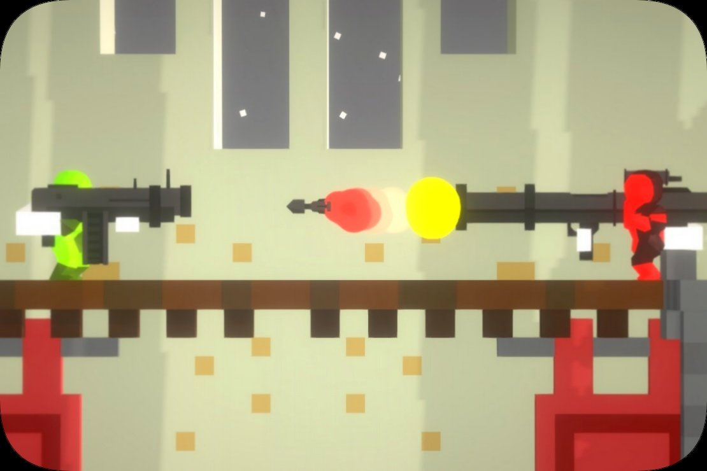

# Gun Slash

## 프로젝트 소개

- **Gun Slash**: 최대 4명이 한 화면에서 대전하는 로컬 멀티플레이 2D 슈팅 게임. 상대를 맞혀 목숨을 모두 빼앗으면 승리합니다.
- **개발**: 1인 개발 (대학 캡스톤 디자인 과제)
- **환경**: Unity, C#, Corgi Engine (Unity 에셋)
- **기간**: 2021.10 ~ 2021.12 (7주)
- **조작**: 키보드 2명 + 게임패드 4명 중 최대 4명

Corgi Engine의 2D 슈터 기반 위에서, 엔진이 지원하지 않는 로컬 4인 대전 흐름과 무기·돌진 시스템을 직접 만들었습니다.

## 시연 영상 · 플레이

- [▶ 시연 영상 (YouTube)](https://www.youtube.com/watch?v=q-bz3kCp5Ck)
- [🎮 플레이 (itch.io)](https://youngdoo.itch.io/gun-slash)

## 구현 범위

- **로비와 플레이어 참가**: 각 입력 장치의 참가 키로 최대 4명 등록, 2명 이상이면 게임 시작
- **입력 장치 분리**: 하나로 묶여 있던 키보드·패드 입력을 키보드 2개, 패드 4개 각각의 플레이어로 분리
- **체력·목숨 시스템**: 체력이 다하면 목숨을 잃고 부활, 목숨을 모두 잃으면 탈락. 마지막 생존자 승리
- **무기**: 맵에 무기를 무작위로 떨어뜨리고, 주운 무기의 탄을 다 쓰면 기본 무기로 복귀. 접촉하면 터지는 지뢰·미사일
- **나이프 돌진**: 조준 방향으로 일정 거리를 돌진하며 베는 공격, 플레이어별 쿨다운 게이지 UI
- **메뉴·설정**: 패드로 조작 가능한 메뉴 내비게이션, 해상도·전체화면 설정, 게임 종료 후 씬 전환

## 코드 구성

| 폴더 | 설명 |
|---|---|
| `Scripts/` | 직접 작성한 스크립트: 참가 입력 감지(`CheckJoinInput`), 무기 무작위 생성(`WeaponSpawner`), 무기 교체 아이템(`WeaponChange`), 설정 메뉴(`SettingsMenu`) |
| `CorgiEngine_Modifications/` | Corgi Engine 파일에 가한 수정분을 diff로 발췌. 로비·목숨·승패(`MultiplayerLevelManager`), 지뢰·미사일(`Bomb`), 나이프 돌진(`MeleeWeapon`), 게이지 UI(`GUIManager`), 입력(`InputManager`) 등 |

> Corgi Engine은 유료 에셋이라 엔진 파일 전체는 포함하지 않았습니다. 엔진 파일을 수정한 부분만 diff 형식으로 담았습니다.
> - `MeleeWeapon.cs.diff`: Corgi 원본 대비 전체 수정분
> - 나머지: 저장소 업로드 이후의 수정분

## 기술 문서

핵심 설계 3가지(입력 장치 분리, 엔진 시작 흐름에 로비 끼워 넣기, 나이프 돌진)와 온라인 → 로컬 전환 의사결정 기록은 [기술 문서](docs/TechnicalDesign.md)에 정리했습니다.
