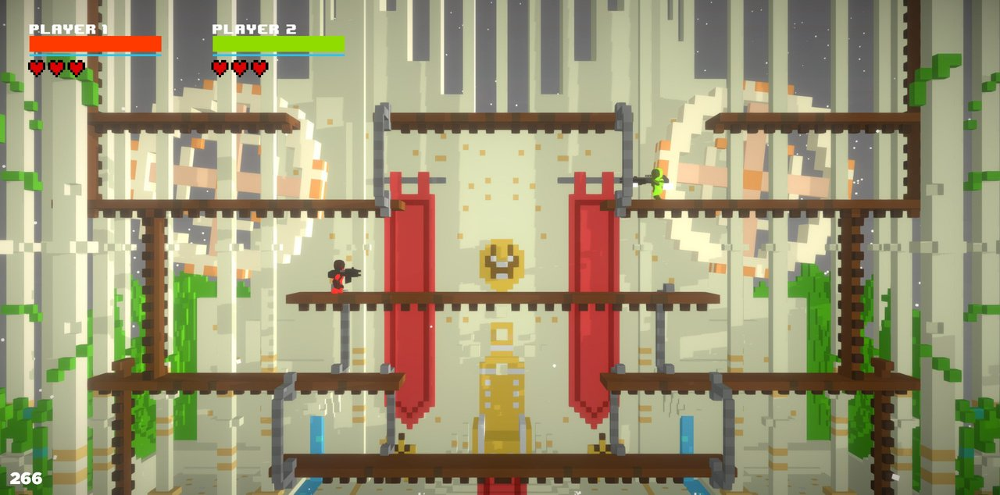
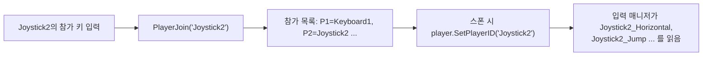
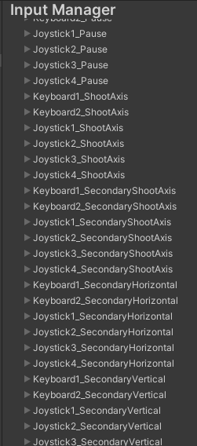
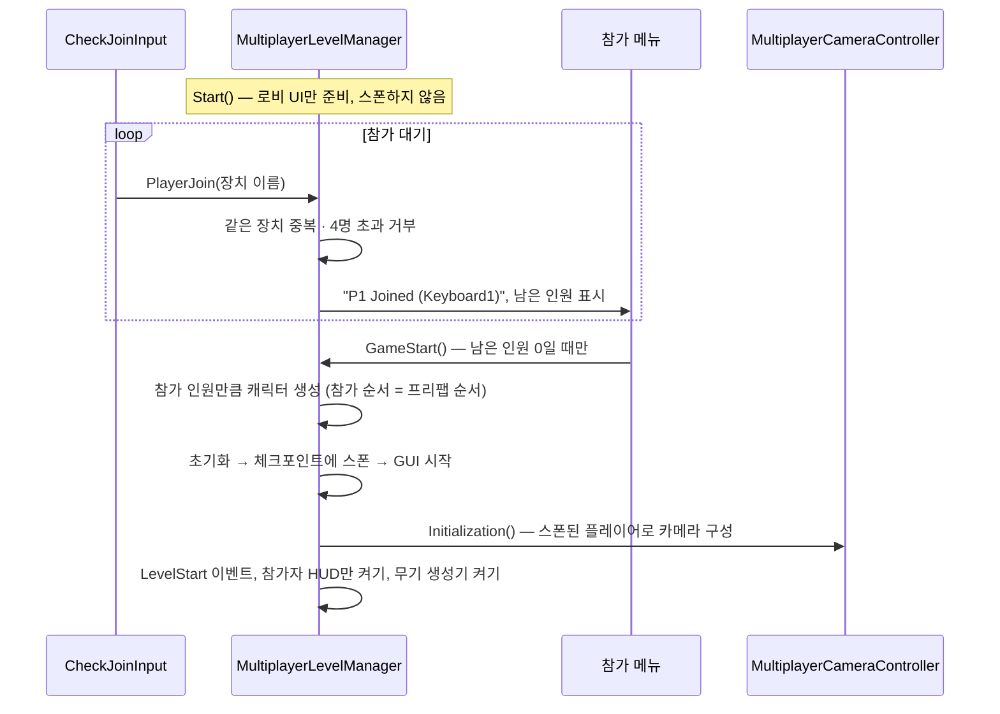
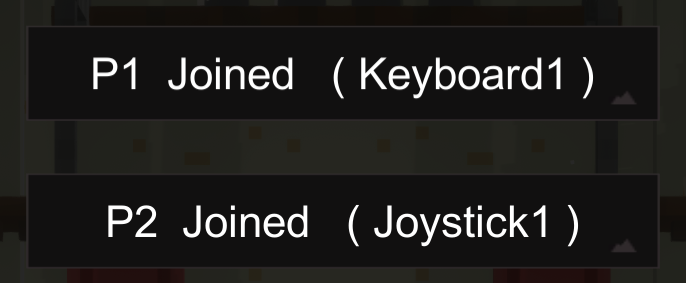
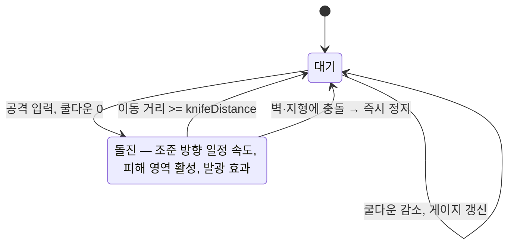
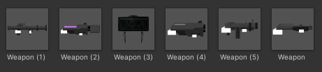
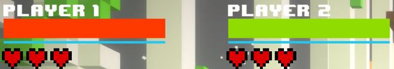
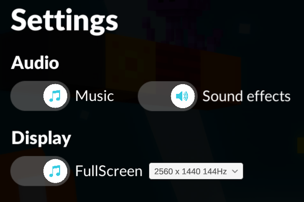

# Gun Slash — 기술 문서

[← README로 돌아가기](../README.md)

## 목차

1. [개요](#1-개요)
2. [핵심 설계 ① 입력 장치 분리](#2-핵심-설계--입력-장치-분리)
3. [핵심 설계 ② 엔진 시작 흐름에 로비 끼워 넣기](#3-핵심-설계--엔진-시작-흐름에-로비-끼워-넣기)
4. [핵심 설계 ③ 나이프 돌진](#4-핵심-설계--나이프-돌진)
5. [그 외 구현](#5-그-외-구현)
6. [의사결정 기록: 온라인 → 로컬 전환](#6-의사결정-기록-온라인--로컬-전환)
7. [한계와 개선 방향](#7-한계와-개선-방향)

---

## 1. 개요

| 항목 | 내용 |
|---|---|
| 장르 | 로컬 멀티플레이 2D 슈팅 (최대 4인 대전) |
| 개발 | 1인, 7주 (2021.10 ~ 12, 대학 캡스톤 디자인) |
| 엔진 | Unity + Corgi Engine (2D 플랫포머/슈터 에셋) |
| 입력 | 키보드 2 + 게임패드 4 중 최대 4명 |



7주 1인 개발이라 이동·사격·피격 같은 기본기와 그래픽은 Corgi Engine에 맡기고, **엔진이 지원하지 않는 부분**에 시간을 썼습니다.

| 엔진이 제공 | 직접 만든 것 |
|---|---|
| 캐릭터 이동·점프·사격, 피격·넉백 | 입력 장치별 플레이어 분리 (2장) |
| 멀티플레이 레벨 매니저 골격, 분할 카메라 | 로비와 참가 인원 기반 스폰 (3장) |
| 근접 무기 | 조준 방향 돌진과 쿨다운 게이지 (4장) |
| 기본 무기·폭탄 | 무기 무작위 생성, 탄 소진 시 복귀, 접촉 폭발 지뢰·미사일, 목숨 시스템 (5장) |

엔진 클래스를 상속해서는 바꿀 수 없는 흐름은 엔진 파일을 직접 수정했고, 저장소에는 그 수정분만 diff로 담았습니다(`CorgiEngine_Modifications/`).

---

## 2. 핵심 설계 ① 입력 장치 분리

### 문제

Corgi의 입력 매니저는 `Player1_Horizontal`, `Player1_Jump`처럼 **플레이어 번호를 접두어로 붙인 입력 축**을 읽습니다. 기본 설정에서는 `Player1_*` 축 하나에 키보드 키와 1번 패드 입력이 함께 묶여 있어, 플레이어 한 명이 키보드와 패드를 같이 쓰는 구조입니다.

기획은 키보드 2명과 패드 4명을 **각각 다른 플레이어**로 쓰는 것이었고, 누가 어떤 장치로 들어올지는 플레이할 때 정해집니다.

### 설계: 참가한 장치 이름을 플레이어 ID로 사용

`Player1~4` 축을 장치 하나씩으로 고정하면 "P1은 항상 키보드1"처럼 번호와 장치가 묶입니다. 대신 **장치 이름 자체를 축 접두어**로 만들고, 참가할 때 누른 장치 이름을 그 캐릭터의 `PlayerID`로 넣었습니다.



```csharp
// CheckJoinInput — 장치마다 참가 키를 감지해 장치 이름으로 등록
if (Input.GetKeyDown(Keyboard1))      multiplayerLevelManager.PlayerJoin(nameof(Keyboard1));
else if (Input.GetKeyDown(Joystick1)) multiplayerLevelManager.PlayerJoin(nameof(Joystick1));
...

// MultiplayerLevelManager.SpawnMultipleCharacters — 참가 순서대로 장치 이름을 PlayerID로
player.SetPlayerID(joinList[i]);
```

Unity Input Manager에는 6개 장치(`Keyboard1`, `Keyboard2`, `Joystick1~4`) × 10개 축을 정의했습니다.



### 함께 바꾼 것

- **표시 이름 분리**: 엔진은 `PlayerID`를 입력 접두어이자 화면 표시 이름("Player1")으로 함께 썼습니다. `PlayerID`가 장치 이름이 되면서 표시용 `playerName` 필드를 따로 두고, 체력 바·나이프 게이지·승자 표시는 이 이름으로 찾게 했습니다.
- **쓰지 않는 버튼 등록 해제**: 수영·활공·제트팩·재장전 등 이 게임에서 쓰지 않는 버튼은 입력 매니저에서 등록하지 않게 했습니다. 장치마다 정의하지 않은 축을 읽다가 오류가 나는 것을 막기 위해서입니다.

### 결과와 한계

- 참가 순서와 장치가 분리되어, 어떤 장치 조합으로든 최대 4명이 들어올 수 있습니다.
- 장치를 하나 더 지원하려면 Input Manager에 축 10개를 복제하고 참가 키 분기를 추가해야 합니다. 새 Input System의 장치 단위 바인딩을 쓰면 이 반복을 없앨 수 있습니다.

**관련 코드**: [`Scripts/CheckJoinInput.cs`](../Scripts/CheckJoinInput.cs), [`MultiplayerLevelManager.cs.diff`](../CorgiEngine_Modifications/MultiplayerLevelManager.cs.diff), [`InputManager.cs.diff`](../CorgiEngine_Modifications/InputManager.cs.diff), [`Character.cs.diff`](../CorgiEngine_Modifications/Character.cs.diff)

---

## 3. 핵심 설계 ② 엔진 시작 흐름에 로비 끼워 넣기

### 문제

엔진의 멀티플레이 레벨 매니저는 씬이 시작되면(`Start`) 정해진 플레이어 프리팹을 **전부 바로 생성·스폰**합니다. 참가 인원이 플레이할 때 정해지는 이 게임에서는, 스폰을 로비가 끝날 때까지 미뤄야 했습니다.

### 설계: 시작 흐름을 `GameStart()`로 옮기기

`Start`를 재정의해 로비 UI만 준비하고, 원래 `Start`에서 하던 생성 → 초기화 → 스폰 → 레벨 시작 이벤트 순서를 `GameStart()`로 옮겼습니다.





- **최소 인원**: 남은 인원 카운터가 2에서 시작해, 2명 이상 참가해야 시작합니다.
- **카메라 초기화 시점**: 원래 카메라는 자신의 `Start`에서 플레이어 목록으로 초기화했습니다. 로비 단계에서는 그 시점에 플레이어가 없으므로, 초기화를 공개 메서드로 바꾸고 스폰 직후에 호출하게 했습니다.
- **씬 재시작 대상**: 경기가 끝나면 엔진은 현재 씬을 다시 불러왔지만, 인스펙터에서 지정한 시작 씬으로 이동하게 바꿨습니다.

**관련 코드**: [`MultiplayerLevelManager.cs.diff`](../CorgiEngine_Modifications/MultiplayerLevelManager.cs.diff), [`MultiplayerCameraController.cs.diff`](../CorgiEngine_Modifications/MultiplayerCameraController.cs.diff)

---

## 4. 핵심 설계 ③ 나이프 돌진

조준 방향으로 일정 거리를 돌진하며 베는 공격입니다. 2021년 4월 팀 프로젝트 Cook Off에서 처음 만든 돌진을 이 프로젝트로 가져와 다듬었고, 이후 [Hollow: Cook Off](https://github.com/Youngdu-Min/Hollow-CookOff-Codes)의 나이프 대시로 발전했습니다.



### 이동

엔진 무기의 "사용 중 힘 적용"은 캐릭터가 바라보는 좌우 방향으로만 힘을 줍니다. 이를 재정의해 **무기의 조준 회전 방향**(`transform.right`)으로 매 프레임 일정 속도를 설정하고, 시작 위치로부터 이동 거리가 `knifeDistance`를 넘으면 끝냅니다.

```csharp
protected override IEnumerator ApplyForceWhileInUseCo()
{
    Vector3 v = (Owner.IsFacingRight ? transform.right : -transform.right) * knifeSpeed;
    while (_applyForceWhileInUse)
    {
        _distanceTraveled = Vector3.Distance(_initialPosition, transform.position);
        _controller.SetForce(ForceToAim ? v : _forceWhileInUse);   // 요약: ForceToAim이면 조준 방향, 아니면 엔진 기본(좌우)
        if (_distanceTraveled >= knifeDistance) { TurnWeaponOff(); yield break; }
        yield return null;
    }
}
```

### 판정과 예외 처리

| 상황 | 처리 |
|---|---|
| 벽·지형에 닿음 | 속도 0, 피해 영역 끄기, 이동 다시 허용 |
| 자기 캐릭터 | 피해 판정이 소유자를 무시하도록 등록 |
| 땅에 선 채 아래·대각선 아래 조준 | 돌진하지 않음 (바닥으로 파고드는 것 방지) |
| 왼쪽을 볼 때 | 피해 영역 좌우 반전 |

### 플레이어별 쿨다운 게이지

엔진 `GUIManager`의 플레이어별 게이지 구조(제트팩 연료 등)를 따라 `UpdateKnifeBar`를 추가하고, 표시 이름이 일치하는 게이지만 갱신합니다. 네 명이 한 화면을 쓰므로 각자의 쿨다운이 자기 HUD에만 보여야 합니다.

**관련 코드**: [`MeleeWeapon.cs.diff`](../CorgiEngine_Modifications/MeleeWeapon.cs.diff) (Corgi 원본 대비 전체 수정분), [`GUIManager.cs.diff`](../CorgiEngine_Modifications/GUIManager.cs.diff)

---

## 5. 그 외 구현

| 기능 | 동작 | 관련 코드 |
|---|---|---|
| 목숨 | 체력이 0이면 목숨이 남은 동안 부활하고 HUD 하트를 빈 하트로 교체. 목숨이 없으면 탈락, 마지막 생존자 승리 | [`MultiplayerLevelManager.cs.diff`](../CorgiEngine_Modifications/MultiplayerLevelManager.cs.diff) |
| 무기 생성 | 일정 간격으로 맵 위쪽의 무작위 위치에 무작위 무기를 떨어뜨림 | [`WeaponSpawner.cs`](../Scripts/WeaponSpawner.cs) |
| 무기 교체 | 닿으면 해당 무기로 교체. **탄을 다 쓰면 시작 무기로 복귀**해 무기를 계속 차지하려는 동선이 생김 | [`WeaponChange.cs`](../Scripts/WeaponChange.cs), [`Weapon.cs.diff`](../CorgiEngine_Modifications/Weapon.cs.diff) |
| 지뢰·미사일 | 폭발 타이머 대신 무장 시간이 지난 뒤 닿으면 폭발. 설치 직후에는 터지지 않아 설치자가 바로 맞지 않음. 여러 번 폭발 옵션 | [`Bomb.cs.diff`](../CorgiEngine_Modifications/Bomb.cs.diff) |
| 패드 메뉴 조작 | 일시정지 메뉴를 열 때 첫 버튼을 선택해 패드만으로 조작 | [`GameManager.cs.diff`](../CorgiEngine_Modifications/GameManager.cs.diff) |
| 설정 | 지원 해상도 목록 드롭다운, 전체화면 | [`SettingsMenu.cs`](../Scripts/SettingsMenu.cs) |



<p>


</p>

---

## 6. 의사결정 기록: 온라인 → 로컬 전환

### 배경

처음 목표는 온라인 대전이었습니다. 개발 4주 차(2021.11.09 ~ 11.20, 약 12일)에 Unity의 UNet으로 시도했습니다.

### 시도한 방식

| 스크립트 | 내용 |
|---|---|
| `MultiplayerLevelManager_Online` (968줄) | 엔진의 레벨 매니저를 복사해 UNet `NetworkManager`를 상속하도록 변경 |
| `MultiplayerCameraController_Online` | 위 매니저에서 플레이어 목록을 읽도록 카메라 복사본 작성 |
| `CharacterLevelBounds_Online` | 위 매니저에서 레벨 경계를 읽도록 경계 처리 복사본 작성 |

### 막힌 지점

- **싱글톤 의존의 연쇄**: Corgi에서 `LevelManager.Instance`를 직접 참조하는 스크립트는 19개입니다(카메라, 레벨 경계, 체크포인트, 체력, 게임 매니저 등). 매니저를 네트워크용으로 바꾸자 이를 참조하는 컴포넌트마다 `_Online` 복사본을 만들어야 했고, 범위가 계속 늘어났습니다.
- **네트워크를 모르는 캐릭터**: 매니저를 바꿔도 캐릭터의 이동·입력·무기는 네트워크 동기화를 전혀 고려하지 않은 구조였습니다. 플레이어 생성도 여전히 로컬 `Instantiate`였습니다. 동기화하려면 엔진의 캐릭터 계층 전체를 고쳐야 했습니다.

### 결정

남은 기간(약 4주)을 고려해 로컬 멀티플레이로 전환했습니다. 11월 21일 온라인 스크립트를 정리하고, 같은 날 로컬 로비(3장)를 추가했습니다. 그동안 만든 무기·돌진·목숨 시스템은 로컬 환경에서 그대로 쓸 수 있었습니다.

### 돌아보며

- 이미 짜인 엔진에 네트워크를 이식할 때는, 시작 전에 엔진 내부의 싱글톤 의존 범위를 먼저 확인했어야 했습니다.
- 전환을 더 일찍 결정했다면 맵·그래픽 보완에 시간을 쓸 수 있었습니다. 작업 진척을 자주 점검하고, 막힌 기능은 더 빨리 결단해야 한다는 교훈을 얻었습니다.

---

## 7. 한계와 개선 방향

| 항목 | 현재 | 개선 방향 |
|---|---|---|
| 엔진 파일 직접 수정 | 레벨 매니저·무기 등 엔진 파일을 직접 고쳐, 엔진 업데이트 시 충돌 | 상속·이벤트 확장 지점을 우선 쓰고, 불가피한 수정은 패치로 관리 |
| 장치 추가 비용 | 장치마다 입력 축 10개 복제 + 참가 키 분기 | 새 Input System의 장치 단위 바인딩 |
| 레이어 번호 하드코딩 | 폭발·돌진 정지 판정에 레이어 번호(8, 9, 11) 직접 사용 | 레이어 이름 상수 또는 LayerMask 필드 |
| 무기 스폰 위치 | 높이 값이 코드에 고정 | 스폰 영역을 씬 오브젝트로 지정 |
| 무기 아이템 수명 | `Destroy(this, 30)`이 오브젝트가 아닌 컴포넌트만 제거해, 30초 뒤에는 보이지만 주워지지 않음 | `Destroy(gameObject, 30)` |
