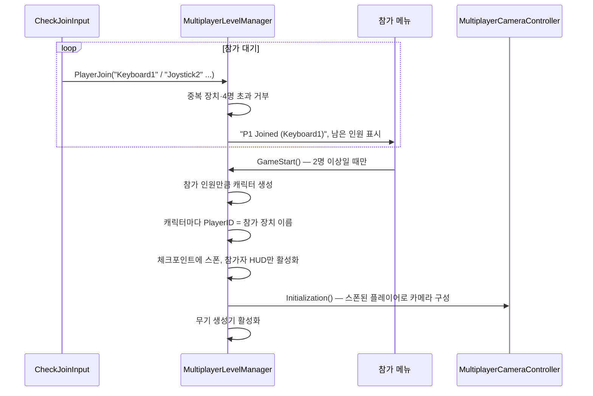
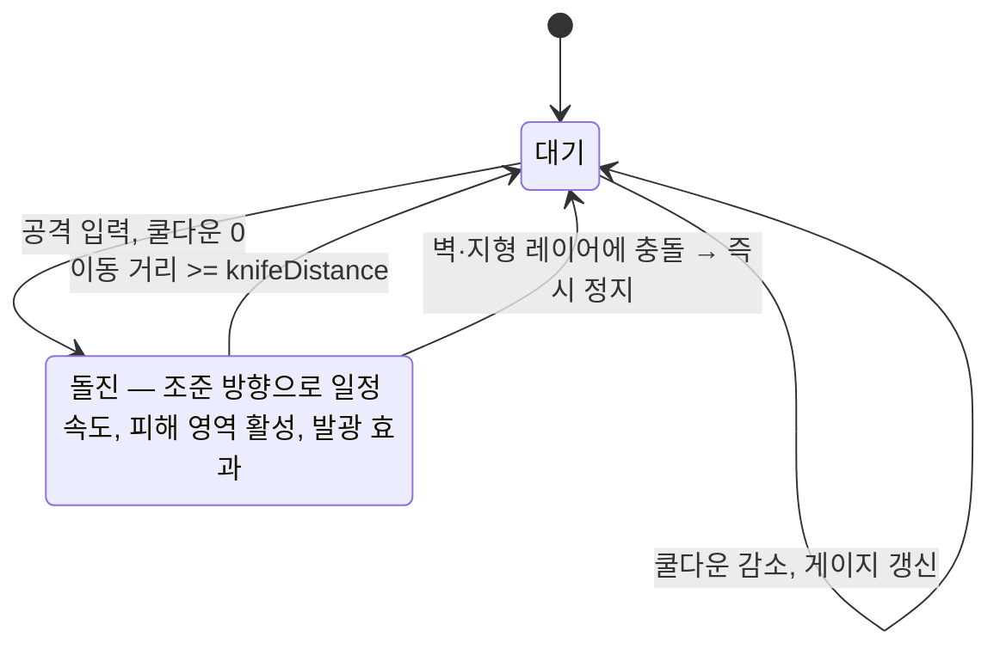

# Gun Slash — 기술 문서

[← README로 돌아가기](../README.md)

## 목차

1. [개요](#1-개요)
2. [작업 방식: 엔진 위에 얹기](#2-작업-방식-엔진-위에-얹기)
3. [로컬 멀티플레이 흐름](#3-로컬-멀티플레이-흐름)
4. [입력 장치 분리](#4-입력-장치-분리)
5. [체력 · 목숨 · 승패](#5-체력--목숨--승패)
6. [무기 시스템](#6-무기-시스템)
7. [나이프 돌진](#7-나이프-돌진)
8. [메뉴 · 설정](#8-메뉴--설정)
9. [개발 과정에서의 판단](#9-개발-과정에서의-판단)
10. [한계와 개선 방향](#10-한계와-개선-방향)

---

## 1. 개요

| 항목 | 내용 |
|---|---|
| 장르 | 로컬 멀티플레이 2D 슈팅 (최대 4인 대전) |
| 개발 | 1인, 7주 (2021.10 ~ 12, 대학 캡스톤 디자인) |
| 엔진 | Unity + Corgi Engine (2D 플랫포머/슈터 에셋) |
| 입력 | 키보드 2 + 게임패드 4 |
| 관리 | GitHub(버전 관리), Notion(작업 종류별 일정·예상 시간 기록) |


---

## 2. 작업 방식: 엔진 위에 얹기

Corgi Engine은 이동·점프·사격·피격 같은 2D 슈터 기본기와 그래픽 에셋을 제공합니다. 7주 1인 개발이라 기본기는 엔진에 맡기고, 시간을 **엔진에 없는 것**에 썼습니다.

| 엔진이 제공 | 직접 만든 것 |
|---|---|
| 캐릭터 이동·점프·사격, 피격·넉백 | 로비와 플레이어 참가, 입력 장치별 플레이어 분리 |
| 기본 무기·투사체·폭탄 | 무기 무작위 생성, 탄 소진 시 기본 무기 복귀, 접촉 폭발형 지뢰·미사일 |
| 멀티플레이 레벨 매니저 골격, 분할 카메라 | 목숨 시스템과 HUD, 참가 인원만큼 스폰, 승패 후 시작 씬으로 복귀 |
| 근접 무기 | 조준 방향 돌진 + 쿨다운 게이지 |

엔진 클래스를 상속할 수 없는 부분(레벨 매니저의 스폰 흐름, 무기의 상태 처리 등)은 엔진 파일을 직접 수정했습니다. 저장소에는 그 수정분만 diff로 담았습니다(`CorgiEngine_Modifications/`).

---

## 3. 로컬 멀티플레이 흐름

엔진의 멀티플레이 레벨 매니저는 씬이 시작되면 정해진 인원을 바로 스폰합니다. 여기에 **로비 단계**를 끼워 넣어, 실제로 참가한 인원만 스폰하도록 바꿨습니다.




- **시작 조건**: 남은 인원 카운터(2에서 시작)가 0이 되어야 시작 버튼이 동작합니다. 혼자서는 대전이 성립하지 않기 때문입니다.
- **카메라 초기화 시점 변경**: 원래 카메라는 시작 시 플레이어 목록으로 초기화했습니다. 로비 단계가 생기면서 그 시점에는 플레이어가 없으므로, 초기화 메서드를 공개로 바꾸고 스폰 직후에 호출하도록 했습니다.
- **플레이어 표시 이름 분리**: 원래 엔진은 `PlayerID`를 이름 표시와 입력 접두어에 함께 썼습니다. 이 프로젝트에서는 `PlayerID`를 입력 장치 이름으로 쓰므로, 화면 표시용 `playerName`("Player1" …) 필드를 따로 두고 체력 바·승자 표시는 이 이름으로 찾게 했습니다.

---

## 4. 입력 장치 분리

엔진은 플레이어 하나가 키보드와 패드를 함께 쓰도록 묶여 있었습니다. 기획은 **키보드와 패드를 각각 다른 플레이어**로 쓰는 것이었습니다.

**해결: 참가 장치 이름을 입력 접두어로 사용**

Corgi의 입력 매니저는 `{PlayerID}_Jump`, `{PlayerID}_Horizontal`처럼 플레이어 ID를 접두어로 붙인 입력 축을 읽습니다. 그래서 참가할 때 누른 장치 이름을 그대로 `PlayerID`로 지정했습니다.

```csharp
// CheckJoinInput — 장치별 참가 키
if (Input.GetKeyDown(Keyboard1))      multiplayerLevelManager.PlayerJoin(nameof(Keyboard1));
else if (Input.GetKeyDown(Joystick1)) multiplayerLevelManager.PlayerJoin(nameof(Joystick1));
...

// MultiplayerLevelManager.SpawnMultipleCharacters
player.SetPlayerID(joinList[i]);   // "Keyboard1", "Joystick1" ... → 입력 축 접두어
```

Unity Input Manager에 6개 장치(`Keyboard1`, `Keyboard2`, `Joystick1~4`) × 축 10개를 하나씩 정의했습니다. 장치를 꽂은 순서나 플레이어 번호와 상관없이, 참가한 장치의 입력만 해당 캐릭터로 들어갑니다.


- 게임에서 쓰지 않는 버튼(수영, 활공, 제트팩, 재장전 등)은 입력 매니저에서 등록을 막았습니다. 장치마다 정의하지 않은 축을 읽으려다 오류가 나는 것을 막기 위해서입니다.

---

## 5. 체력 · 목숨 · 승패


- **목숨**: 체력이 0이 되면 목숨이 남아 있는 한 부활 지점에서 다시 스폰하고, HUD의 하트를 빈 하트 스프라이트로 바꿉니다.
- **탈락**: 목숨이 없으면 플레이어를 제거합니다.
- **승패**: 살아남은 플레이어가 한 명이 되면 그 플레이어의 표시 이름으로 승자를 띄웁니다. 2초 뒤 인스펙터에서 지정한 시작 씬으로 이동합니다. 원래 엔진은 현재 씬을 다시 불러왔지만, 지정한 씬부터 다시 시작하도록 바꿨습니다.
- **HUD**: 참가한 인원 수만큼만 플레이어 HUD를 켭니다.

---

## 6. 무기 시스템


### 6.1 무기 생성과 교체

| 스크립트 | 동작 |
|---|---|
| `WeaponSpawner` | 일정 간격마다 맵 위쪽의 무작위 x 위치에 무작위 무기를 떨어뜨림 |
| `WeaponChange` | 플레이어가 닿으면 해당 무기로 교체하고 사라짐 |
| `Weapon` 수정 | 시작 무기를 기억해 두고, **탄을 다 쓰면 기본 무기로 복귀** |

```csharp
// Weapon — 탄 소진 시 기본 무기로 복귀
if (CurrentAmmoLoaded <= 0 && AutoDestroyWhenEmpty)
{
    WeaponState.ChangeState(WeaponStates.WeaponStop);
    CharacterHandleWeapon.ChangeWeapon(weapondata, "1", false);
}
```

좋은 무기를 주워도 탄이 떨어지면 기본 무기로 돌아가므로, 맵에 떨어지는 무기를 계속 차지하려는 동선이 생깁니다.

### 6.2 접촉 폭발형 무기 (`Bomb` 수정)

엔진의 폭탄은 타이머가 끝나야 터집니다. 지뢰와 미사일을 위해 **닿으면 터지는 모드**를 추가했습니다.

- `NotWaitExplosion`이 켜져 있으면 폭발 타이머 대신 **무장 시간**이 흐르고, 무장이 끝난 뒤 플레이어나 지형 레이어에 닿는 순간 폭발합니다. 설치 직후에는 닿아도 터지지 않아 설치한 사람이 바로 맞지 않습니다.
- 일반 타이머 모드에서도 대상에 닿으면 타이머를 건너뛰고 바로 폭발합니다.
- 여러 번 터지는 옵션(`bombMultipleTime`)을 두었고, 풀에서 재사용될 때는 초기 모드로 되돌립니다.

---

## 7. 나이프 돌진

조준 방향으로 일정 거리를 돌진하며 베는 공격입니다. 이 돌진은 이후 팀 프로젝트 [Hollow: Cook Off](https://github.com/Youngdu-Min/Hollow-CookOff-Codes)의 나이프 대시로 발전했습니다.



- **조준 방향 이동**: 무기의 조준 회전을 따라 `transform.right × knifeSpeed`로 매 프레임 속도를 설정합니다. 엔진의 "사용 중 힘 적용" 기능을 재정의해, 좌우 고정 방향이 아니라 조준 방향으로 밀리게 했습니다(`ForceToAim`).
- **거리 제한**: 시작 위치에서 이동한 거리가 `knifeDistance`를 넘으면 돌진을 끝냅니다.
- **벽 충돌 정지**: 피해 판정이 벽·지형 레이어에 닿으면 속도를 0으로 하고 판정을 끕니다.
- **자기 피격 방지**: 피해 판정이 자기 캐릭터를 무시하도록 등록합니다.
- **바닥 방향 차단**: 땅에 선 채로 아래나 대각선 아래를 조준하면 돌진하지 않습니다. 바닥으로 파고드는 것을 막기 위해서입니다.

**플레이어별 쿨다운 게이지**

엔진의 `GUIManager`에는 제트팩 연료처럼 플레이어별 게이지를 갱신하는 구조가 있습니다. 같은 방식으로 `UpdateKnifeBar`를 추가해, 플레이어 이름이 일치하는 게이지만 갱신합니다.

```csharp
public virtual void UpdateKnifeBar(float currentDelay, float minDelay, float maxDelay, string playerID)
{
    foreach (MMProgressBar knifeBar in KnifeBars)
    {
        if (knifeBar != null && knifeBar.PlayerID == playerID)
            knifeBar.UpdateBar(currentDelay, minDelay, maxDelay);
    }
}
```

---

## 8. 메뉴 · 설정


- **해상도**: 모니터가 지원하는 해상도 목록으로 드롭다운을 만들고, 현재 해상도를 기본 선택합니다. 시작 시 최대 해상도와 전체화면으로 설정합니다.
- **패드 메뉴 내비게이션**: 일시정지 메뉴를 열 때 EventSystem의 선택을 첫 버튼으로 지정해, 마우스 없이 패드만으로 메뉴를 조작할 수 있게 했습니다.

---

## 9. 개발 과정에서의 판단

**온라인 멀티플레이 → 로컬 멀티플레이 전환**

처음에는 온라인 대전이 목표였습니다. 네트워크용 레벨 매니저·카메라·경계 처리 스크립트를 만들어 시도했지만, 정교하게 짜인 엔진 구조에 네트워크 동기화를 이식하는 데 계속 막혔습니다. 남은 기간을 고려해 로컬 멀티플레이로 전환했고, 네트워크용 스크립트는 정리했습니다.

**회고**
- 엔진을 기반으로 해 조작감과 그래픽 품질은 확보했고, 에셋을 따로 구하는 시간을 아꼈습니다.
- 구현하지 못한 온라인 기능에 시간을 많이 써서 맵·그래픽 보완은 하지 못했습니다. 진척을 더 자주 점검하고 전환 결정을 빨리 내렸어야 했습니다.
- 4인 대전 게임이라 혼자서 밸런스를 잡기가 까다로웠습니다.

---

## 10. 한계와 개선 방향

| 항목 | 현재 | 개선 방향 |
|---|---|---|
| 엔진 파일 직접 수정 | 레벨 매니저·무기 등 엔진 파일을 직접 고침. 엔진 업데이트 시 충돌 | 상속·확장 지점을 활용하고, 불가피한 수정은 패치로 관리 |
| 레이어 번호 하드코딩 | 폭발·돌진 정지 판정에 레이어 번호(8, 9, 11) 직접 사용 | 레이어 이름 상수 또는 LayerMask 필드 |
| 무기 스폰 위치 | 높이 값이 코드에 고정 | 스폰 영역을 씬 오브젝트로 지정 |
| 참가 키 처리 | 장치마다 `if` 분기 | 장치 목록을 순회하는 방식으로 일반화 |
| 무기 아이템 수명 | `Destroy(this, 30)`이 오브젝트가 아닌 컴포넌트만 제거해, 30초 뒤에는 무기 아이템이 보이지만 주워지지 않음 | `Destroy(gameObject, 30)`으로 오브젝트 제거 |
